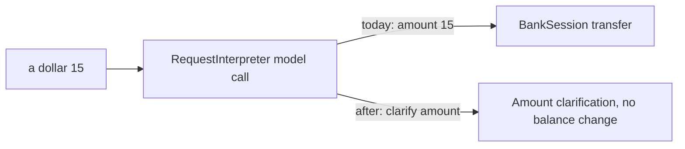

# Clarify ambiguous dollar amounts

## Problem

"transfer a dollar 15 from savings to checking" currently moves $15.00. The phrase could mean $1.15 or $15.00. `InitialDescription.md` says: "If a required detail is missing or unclear, ask for it before changing either balance."

The model is the only part of the app that reads amount wording. [BankingCli/RequestInterpreter.cs](BankingCli/RequestInterpreter.cs) checks only that the returned `amount` string is a valid number, so a guessed amount passes validation. The existing `amount` clarification path and its message ("Please include a positive dollar amount with up to two decimal places and try again.") already do what we need. The fix is to make the model use that path for ambiguous amounts.



## Changes

### 1. Interpreter instructions in [BankingCli/RequestInterpreter.cs](BankingCli/RequestInterpreter.cs)

Add these rules after the existing "Convert clear amounts..." sentence in `Instructions`:

- An amount is clear only when its words or digits have one reading, such as `$1.15`, `1.15`, `fifteen dollars`, `one dollar and fifteen cents`, or `a dollar fifteen cents`.
- If a dollar amount is followed by a bare number with no "cents" or decimal point, such as `a dollar 15`, `a dollar fifteen`, or `five 20`, return `clarify` with message `amount`.
- Never choose between two possible readings.

The schema, validation, and messages stay the same.

### 2. Scripted test in [BankingCli.Tests/ConversationLoopTests.cs](BankingCli.Tests/ConversationLoopTests.cs)

Add this case to the `ClarificationLeavesBothBalancesUnchanged` theory:

```csharp
[InlineData("Transfer a dollar 15 from savings to checking", "clarify", "amount", "positive dollar amount")]
```

This checks the app behavior when the model asks for the amount: the clarification is shown, balances do not change, and the model is called once. It does not test what the model returns.

### 3. Live tests in [BankingCli.Tests/LiveApiTests.cs](BankingCli.Tests/LiveApiTests.cs)

These tests call the configured model and verify that the new instructions work.

- Add a `[LiveTheory]` named `AmbiguousAmountAsksForClarification` to `LiveApiFailureTests`, with these inputs:
  - `Transfer a dollar 15 from savings to checking`
  - `Transfer a dollar fifteen from savings to chequing`
  - `Withdraw five 20 from savings`
- Each case starts with `deposit savings 10` and asserts:
  - The transcript contains the amount clarification message.
  - Balances remain `chequing=$0.00 | savings=$10.00`.
- Add a `[LiveTheory]` named `UnambiguousCentAmountsTransferExactly` to `LiveApiSuccessTests` to make sure the fix does not reject clear amounts. Each case starts with `deposit savings 10`, then transfers to chequing and asserts the final balance is `chequing=$1.15 | savings=$8.85`. Use these inputs:
  - `Transfer $1.15 from savings to chequing`
  - `Transfer one dollar and fifteen cents from savings to chequing`
  - `Transfer a dollar fifteen cents from savings to chequing`

### 4. README in [README.md](README.md)

- Rewrite the unfinished "How I worked" bullets on lines 85-87 as complete sentences. Describe the `a dollar 15` bug, the fix, and how it was checked with the live test.
- Mention that `dotnet test --filter Category=Live` runs the live model tests using `.env`.

## Verification

- Run `dotnet test BankingCli.sln` to confirm the scripted tests pass. Live tests are skipped unless `.env` is configured.
- Run `dotnet test BankingCli.sln --filter Category=Live` against the configured model. Confirm the new ambiguous-amount and exact-cents cases pass, along with the existing live tests.
- Manually run `dotnet run --project BankingCli`, enter `deposit savings 10`, then `transfer a dollar 15 from savings to checking`, then `balance`. Expect the amount clarification and unchanged balances.