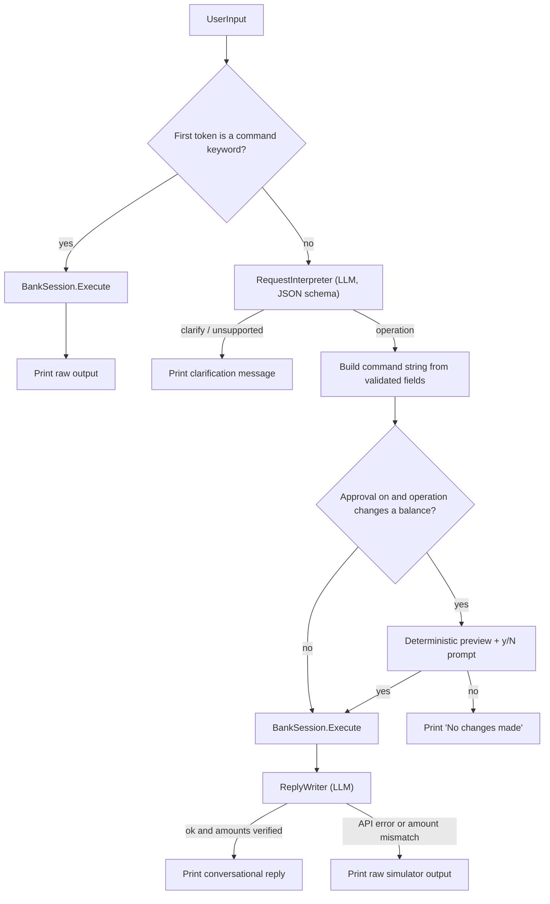

# Natural-language banking CLI with user approval

## Request flow

## Key design decisions
- **Typed commands run directly.** If the first token is `deposit|withdraw|transfer|balance|help|?|exit`, the input goes straight to `BankSession.Execute` and the raw output is printed, the same as the starter. There's no API call and no approval, so typed commands keep working without a key.
- **The model never writes the command string.** The interpreter uses Chat Completions with structured output (a JSON schema): `{ kind: "operation"|"clarify"|"unsupported", operation, from, to, amount, message }`. Accounts are limited to `chequing|savings`, and the amount is a string. C# checks the fields and builds the command, which `BankSession` validates again. "Exit" and "help" are never produced from plain English.
- **Missing details are handled without memory between turns.** If the account, the amount, or a transfer direction is missing or ambiguous, the model returns `clarify` and we print its message ("Please include ... when you try again"). Nothing runs.
- **Approval applies only to plain-English requests that change a balance** (deposit, withdraw, transfer). The preview text is built in C#, not by the model, so it shows exactly what will run, for example: `About to run: transfer savings chequing 4  (move $4.00 from savings to chequing). Proceed? [y/N]`. Only `y` or `yes` approves. Anything else, or end of input, cancels, and no reply call is made.
- **Piped input:** the approval answer is read from the next input line without printing the prompt, matching the starter's `Console.IsInputRedirected` convention.
- **Reply fallback:** if the reply API call throws or times out, or if any `$x.xx` in the reply doesn't appear in the simulator output, we print the raw simulator output. The command is never run again.
- **No API key configured:** typed commands still work. Plain-English input prints a one-line "AI is not configured; use commands (type help)" message.

## Files
- [BankingCli/BankSession.cs](BankingCli/BankSession.cs): no logic changes.
- [BankingCli/Program.cs](BankingCli/Program.cs): becomes a thin entry point that loads config, wires up dependencies, and runs the loop.
- New `BankingCli/AppConfig.cs`: a small `.env` loader (process environment variables take priority), reading `OPENAI_API_KEY`, `OPENAI_BASE_URL` (optional), `OPENAI_MODEL`, `OPENAI_REASONING` (optional, only sent if set), and `USER_APPROVAL_REQUIRED` (default `true`).
- New `BankingCli/Ai/IChatModel.cs` plus `OpenAiChatModel.cs`, using the official `OpenAI` NuGet package's `ChatClient` with a custom endpoint, JSON-schema response format, and a timeout.
- New `BankingCli/RequestInterpreter.cs`: NL to `Interpretation` (a command string plus preview text, or a message).
- New `BankingCli/ReplyWriter.cs`: takes the user's request, the command, and the simulator output, and returns reply text or the raw-output fallback (including the amount check).
- New `BankingCli/ConversationLoop.cs`: the flow above, built on an `IConsoleIO` abstraction so tests can script input.
- Add `InternalsVisibleTo("BankingCli.Tests")` to the csproj.
- New `BankingCli.Tests/` (xUnit, added to [BankingCli.sln](BankingCli.sln)) with a fake `IChatModel` covering: typed commands bypass the model; clarify leaves balances unchanged; approval yes runs the command and approval no doesn't; balance checks skip approval; reply failure prints the raw output and runs the command once; an amount mismatch falls back; an invalid model JSON or account is rejected.
- [.env.example](.env.example): add a commented `OPENAI_BASE_URL`.
- [README.md](README.md): config section, approval behaviour, example inputs, three documented checks (a successful transfer, a clarification, and an insufficient-funds failure), and the remaining "How I worked" bullets.

## Prerequisite
- Install the .NET 10 SDK locally (`dotnet` is not currently on the PATH) so we can build, test, and run the manual checks.
