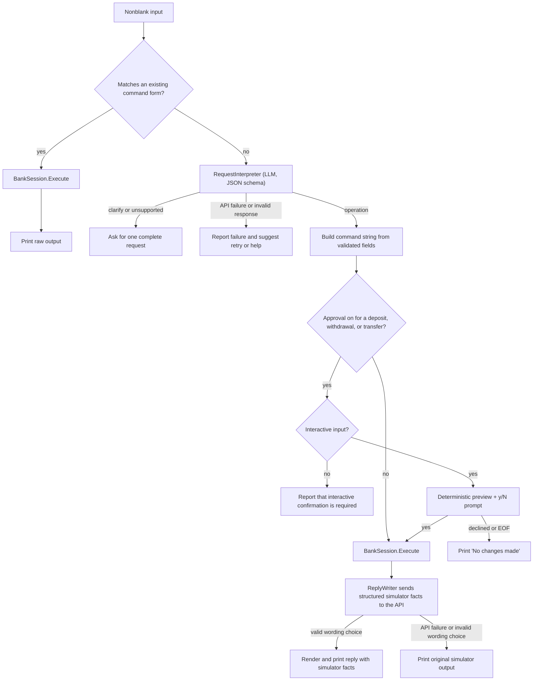

# Natural-language banking CLI with user approval

## Request flow

## Key design decisions

- **Route by command syntax.** Recognize the starter's positional command forms and standalone `help`, `?`, and `exit`, preserving case-insensitive matching and whitespace handling. Send matching inputs directly to `BankSession.Execute` and print its raw output. Inputs such as “Transfer four dollars from savings to chequing” and “Deposit $10 into savings” go to the interpreter. Blank lines keep their existing behavior.
- **Interpret one operation per request.** Use Chat Completions with a JSON schema for the interpretation kind, operation, source and destination accounts, amount string, balance scope, and clarification message. Use explicit `chequing`, `savings`, and `both` scopes for balance requests. C# validates the fields for the requested operation and builds one canonical command from the allowed operations, accounts, and amount format. `BankSession` still checks whether the operation can proceed.
- **Ask for missing or ambiguous details before execution.** Ask the user to resubmit a complete request when an amount, account, or transfer direction is unclear. Ask for one operation at a time when the user requests multiple operations. Each input is independent. If the interpretation call fails or returns invalid data, report that the request could not be interpreted and leave balances unchanged. Without an API key, matching commands still work and plain-English input directs the user to `help`.
- **Make approval opt-in.** `USER_APPROVAL_REQUIRED` defaults to `false`. When enabled, prompt before executing a plain-English deposit, withdrawal, or transfer. Build the preview from the validated command and show the amount and account or accounts. Accept only `y` or `yes`. Any other answer or end of input cancels the request. If input is redirected, report that interactive confirmation is required, leave balances unchanged, and continue with the next input as a new command. Balance checks and direct commands skip approval.
- **Use simulator facts in the reply.** Extend `CommandResult` with structured facts for the outcome, operation, requested amount, account roles, reported balances, and decline reason where applicable. Preserve the original output for direct commands and fallback. After executing a natural-language command once, send those facts to the reply API and ask it to select an allowed conversational phrase for the result. C# checks that the wording choice fits the result and fills in the amounts, accounts, and balances. On an API error, timeout, or unusable choice, print the original output from that execution.

## Files

- [`BankingCli/BankSession.cs`](../../BankingCli/BankSession.cs) supplies structured result facts alongside the existing output and exit flag, using the existing validation and balance updates.
- [`BankingCli/Program.cs`](../../BankingCli/Program.cs) becomes a thin entry point that loads config, wires up dependencies, and runs the loop.
- `BankingCli/AppConfig.cs` loads `.env` with process environment variables taking precedence. Read `OPENAI_API_KEY`, `OPENAI_MODEL`, optional `OPENAI_BASE_URL` and `OPENAI_REASONING`, and `USER_APPROVAL_REQUIRED` with a default of `false`. Send the reasoning setting only when configured.
- `BankingCli/Ai/IChatModel.cs` and `OpenAiChatModel.cs` provide the model interface and official `OpenAI` NuGet package adapter using `ChatClient` with a configurable endpoint, JSON-schema response format, and a timeout.
- `BankingCli/RequestInterpreter.cs` turns plain English into a validated command and preview or a request for clarification.
- `BankingCli/ReplyWriter.cs` sends the structured result to the model, renders the selected wording with simulator facts, and returns the raw result on failure.
- `BankingCli/ConversationLoop.cs` handles syntax-based command routing and approval. Use `IConsoleIO` so tests can script interactive and redirected input.
- `BankingCli.Tests/` is an xUnit project in [`BankingCli.sln`](../../BankingCli.sln). Use a fake `IChatModel` for the CLI tests and expose internals to the test assembly.
- [`.env.example`](../../.env.example) includes a commented `OPENAI_BASE_URL` and shows approval off by default.
- [`README.md`](../../README.md) documents build and run steps, API setup, examples, approval behavior, observed check results, and how the solution was built and verified.

## Verification and submission

1. Install the .NET 10 SDK and confirm the starter builds and runs. Once the API adapter is in place, smoke-test both calls using the configured endpoint and model. Verify that the provider accepts the structured-output schemas and returns a usable interpretation and wording choice.
2. Run the automated tests. Cover direct command compatibility, including `help`, `?`, `exit`, and operation-prefixed English. Exercise deposits, withdrawals, transfers, balance checks for either account and both accounts, and a simulator decline. Verify that missing, ambiguous, and multi-operation requests leave both balances unchanged.
3. With approval on, test confirmation, cancellation, end of input, and redirected input that leaves the next command available. With approval off, verify that a valid transaction runs without a prompt. Verify that balance checks skip approval.
4. Exercise both API failure paths. An interpretation timeout, invalid JSON, or invalid account must leave both balances unchanged. A reply API failure or invalid wording choice after a successful transfer must print the original simulator result. Check both balances to confirm the transfer took effect exactly once. Verify that rendered success and decline replies use the correct account roles and amounts.
5. Run and document three manual checks with observed results. Seed savings with $10.00, then transfer $4.00 to chequing and verify $6.00 and $4.00. Submit a transfer with a missing destination, then check that both balances stayed the same. Try a transfer that exceeds the available balance and verify the conversational decline and unchanged balances.
6. Finish the README's workflow notes with the tools and models used, where known, how they fit into the work, and one suggestion that was accepted, changed, or rejected and how the decision was verified. Check that the chosen ZIP or public repository includes the runnable .NET 10 solution and README and excludes credentials.

## Prerequisite

- Install the .NET 10 SDK locally so the starter and the updated solution can be built and run.
